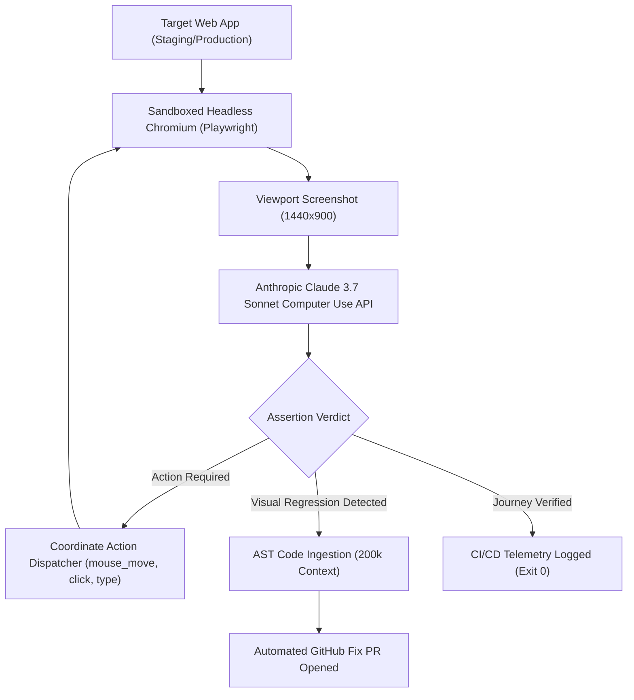

# SynapseQA &mdash; Autonomous Web QA Engine Powered by Claude Computer Use

<p align="center">
  <a href="https://github.com/yakupakcay-eng/synapseqa/actions/workflows/ci.yml"></a>
  <a href="https://opensource.org/licenses/MIT"></a>
  <a href="https://www.anthropic.com"></a>
  <a href="https://nodejs.org">=%2020.0.0-green.svg" alt="Node Version" /></a>
  <a href="https://www.synapseqa.me"></a>
</p>

> **Ship flawless web applications with zero brittle selectors.**  
> SynapseQA uses **Anthropic Claude 3.7 Sonnet Computer Use & Multimodal Vision** to autonomously navigate web applications, assert user journeys, detect visual layout shifts, and open automated GitHub Pull Requests with code fixes.

---

## 🏗️ Architecture Overview



---

## ⚡ Quickstart

### 1. Run Autonomous Test Journey via CLI
No installation required:
```bash
# Test any web application autonomously
npx synapseqa --target="https://stage.myapp.dev" --autonomous

# Run pre-configured test journey with auto-PR generation
npx synapseqa run --scenario=checkout --auto-pr
```

### 2. Local Development (Web Platform)
```bash
# Install dependencies
npm install

# Run Vite dev server
npm run dev

# Run linter & test
npm run lint
npm run test:cli
```

### 3. Agent Engine (Python Backend)
For developers integrating custom headless browser clusters:
```bash
cd agent
pip install -r requirements.txt
python computer_use.py
```

---

## 🎯 Why SynapseQA vs Legacy Testing?

| Feature | SynapseQA (Claude) | Cypress / Playwright | Manual QA |
| :--- | :--- | :--- | :--- |
| **Test Creation** | Plain English Prompts | Fragile CSS/XPath Selectors | Spreadsheets & Checklists |
| **Refactor Resilience** | **100% (Visual Perception)** | Breaks on class/DOM rename | High but Slow |
| **Execution Speed** | < 15s per user journey | Fast (if selectors unbroken) | Days |
| **Bugfix Generation** | **Automatic GitHub PR** | Manual Jira Tickets | Manual Jira Tickets |
| **Flakiness Rate** | < 0.1% | 15% - 25% | Variable |

---

## 🤖 Claude Computer Use Tool Protocol

SynapseQA communicates with Anthropic's beta Computer Use API via normalized screen coordinates:

```json
{
  "type": "computer_20241022",
  "name": "computer",
  "action": "mouse_move",
  "coordinate": [842, 310]
}
```

---

## 📄 License
This project is licensed under the [MIT License](LICENSE) &copy; 2026 Yakup Akçay / SynapseQA Inc.
All rights reserved.
